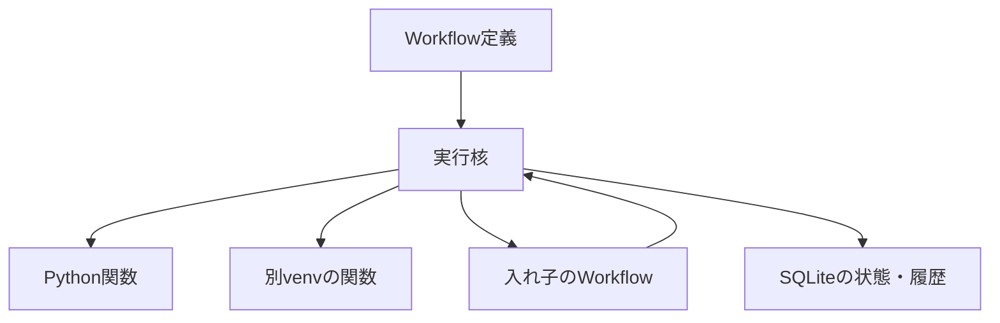

# Seed Harness Core

**ハーネスの判断ループも、業務処理も、同じWorkflowとして組むための実行核。**

まず **[QUICKSTART.md](QUICKSTART.md)** の設定不要デモから始めてください。次の開発計画は **[PLAN.md](PLAN.md)**。

Python 3.11以上。今回の追加実装はWindows・Python 3.13で検証しました。

LLM判断、自然言語CLI、知識の照合・再利用、Workflow／Python Tool候補の生成・検証・版登録を、コアを変更せず上位の関数とWorkflowとして追加しました。
実LLM接続とexecute／ask／finish、CSV処理は`http://192.168.11.12:8080/v1`の`qwen3.8-flash-next`で確認しました。
Workflow／Python Tool／判断ループ候補の実生成、テスト、登録、新runからの実行も確認しました。詳細は[LIVE_VALIDATION.md](LIVE_VALIDATION.md)。
起動・回答・再開・生成の手順は[QUICKSTART.md](QUICKSTART.md)、設定と制約は[HARNESS.md](HARNESS.md)、今回の結果は[VALIDATION.md](VALIDATION.md)を参照してください。

## できること

| 要素 | 実装 |
|---|---|
| 関数の登録・呼び出し | `Registry`。同一プロセス／指定Pythonのsubprocess |
| 関数の連鎖・分岐・反復 | JSONのWorkflow。明示的な遷移 |
| WorkflowのTool化 | `kind: workflow`。入れ子、入れ子内の待機も可能 |
| 判断結果によるTool選択 | `call.tool`に参照を指定。登録済みToolだけ実行 |
| 質問・回答待ち | `wait`。質問IDを指定して`resume` |
| 永続化 | SQLite。状態・イベントを同一トランザクションで保存 |
| 入出力検証 | JSON Schema Draft 2020-12 |
| 障害処理 | `on_error`、明示的なretry/recover、総ステップ上限 |
| 知識 | scope/key/value/source/exceptionsをSQLiteに保存。人の回答と仮説を区別し、矛盾を拒否 |
| LLM判断 | OpenAI互換Chat Completions。JSON Schema検証、公開Tool制限、補正上限 |
| CLI | `job / talk / resume --drive`。`create / export-version`で候補生成と版利用 |
| 能力拡張 | 別runで受入テストした候補のみ新しい版として公開 |
| UI連携 | `start / drive / resume / load / events`をPython APIとして提供 |

LLM、MCP、Langflowはコアの依存に含まない。判断関数を差し替えて接続する。

## 最初に動かす

ZIPを展開し、`harness-core`フォルダで実行する。

Windows PowerShell:

```powershell
py -3.12 -m venv .venv
.\.venv\Scripts\python.exe -m pip install -e .
.\.venv\Scripts\python.exe -m unittest discover -s tests -v
.\.venv\Scripts\python.exe -m examples.demo
```

Linux:

```bash
python3 -m venv .venv
.venv/bin/python -m pip install -e .
.venv/bin/python -m unittest discover -s tests -v
.venv/bin/python -m examples.demo
```

デモは一時フォルダに独立したvenvを2個作り、以下を確認する。終了すると一時データを削除する。

1. 判断規則が未登録なので質問して停止。
2. 新しいEngineインスタンスから回答を渡し、規則を保存して再開。
3. venv Aで寸法候補を作り、venv Bで採用値を選ぶ。
4. 単位・採用条件・正の寸法を検証して完了。
5. 同じ条件の次回作業は、保存済みの規則で質問せず完了。

PPT/Excelの実解析はデモに含まない。候補値はサンプルデータ。判断関数も**決定的なテスト用関数**であり、実LLMとの接続確認ではない。
`python -m examples.csv_demo`は実CSVを異なる2つのvenvで処理し、別CLIプロセスからの回答・再開と、60 mm／3件の値・単位・件数・ファイル内容を検証します。

## コアとハーネスの関係



コアが扱う命令は`call / branch / wait / return`の4個。
LLM判断、知識検索、学習、検証、再試行の方針は、登録関数とWorkflowで表す。
`examples/agent_loop.json`がエージェント自身の判断ループの例。

## 関数を登録する

関数はキーワード引数を受け取り、JSON化できる値を返す。

```python
from seed_harness import Registry

registry = Registry({
    "normalize.v1": {
        "kind": "subprocess",
        "description": "抽出文書を正規化する",
        "python": "C:/work/normalize/.venv/Scripts/python.exe",
        "cwd": "C:/work/normalize",
        "entry": "api:normalize",
        "timeout": 300,
        "input_schema": {
            "type": "object",
            "properties": {"input_path": {"type": "string"}},
            "required": ["input_path"],
            "additionalProperties": False
        },
        "output_schema": {
            "type": "object",
            "properties": {"output_path": {"type": "string"}},
            "required": ["output_path"]
        }
    }
})
```

`python / cwd`は絶対パスを指定する。venvのactivateは不要。
対象venvには関数に必要な依存だけを入れる。Workerは標準ライブラリだけで動く。
大きなデータはJSONに詰めず、絶対ファイルパスを渡す。ファイルの存在や内容は別の検証関数で確認する。

同一プロセスなら`{"kind": "python", "entry": "my_package:my_function"}`。
`context: true`を指定すると、`_context`引数でrun_id/node_id/token/depth/stepを受け取れる。
このtokenは**試行ごとに変わる**ため、再試行をまたぐ重複防止には業務側で安定したキーを渡す。

## Workflowを定義する

```json
{
  "schema_version": 1,
  "id": "normalize-document.v1",
  "entry": "normalize",
  "nodes": {
    "normalize": {
      "kind": "call",
      "tool": "normalize.v1",
      "input": {"input_path": {"$ref": "input.document_path"}},
      "next": "finish"
    },
    "finish": {
      "kind": "return",
      "value": {"$ref": "steps.normalize"}
    }
  }
}
```

| 命令 | 主なフィールド |
|---|---|
| `call` | `tool`, `input`, `next`, 任意で`save_as`, `on_error` |
| `branch` | `value`, `cases`, `default` |
| `wait` | `question`, `answer_schema`, `next`, 任意で`save_as` |
| `return` | `value` |

参照は`{"$ref": "input.document_path"}`のような明示的オブジェクトだけ。
`input`はWorkflow入力、`steps.NODE`はそのノードの直近出力、`vars.NAME`は`save_as`で保存した値。
配列は`.0`のように参照する。キー・ノードID・変数名にはドットを使わない。
`${...}`の文字列展開やPython式評価はしない。
ループ時の過去出力はイベントに残り、`steps`には最新値が入る。

`branch.cases`のキーは文字列。数値は`"3"`、真偽値は`"true" / "false"`として指定する。

Workflowも同じRegistryへ登録できる。

```python
registry.register("document.pipeline.v1", {
    "kind": "workflow",
    "workflow": workflow_definition,
    "input_schema": {"type": "object"},
    "output_schema": {"type": "object"}
})
```

上位Workflowからは通常のToolと同じ`call`で呼ぶ。

## 実行・停止・再開

```python
from seed_harness import Engine, Store

store = Store("runs/state.sqlite3")
engine = Engine(registry, store)
run = engine.start(workflow_definition, {"document_path": "C:/data/source.json"})
run = engine.drive(run["id"])

if run["status"] == "waiting":
    print(run["pending"]["question"])
    engine.resume(run["id"], {"selection": "design"},
                  pending_id=run["pending"]["id"])
    run = engine.drive(run["id"])
```

`resume`に渡す回答の形式はその`wait.answer_schema`に合わせる。
`resume`は回答を保存する操作。続行には`drive`を呼ぶ。
`drive`は1回あたり100ノードで一旦返る。`ready`なら再度呼べる。
総ステップ数は`start(..., max_steps=1000)`で制限する。

状態は`ready / running / waiting / completed / failed`。
`running`は1ノードの実行中。新しい実行器が同じノードを勝手に再実行しない。
`Store.events(run_id)`で、分岐・出力・質問・回答・エラーを確認できる。

## CLI

`workflow.json / registry.json / input.json`をUTF-8で用意する。
`registry.json`は上記のRegistryへ渡す辞書と同じ形式。

```bash
seed-harness --db runs/state.sqlite3 start workflow.json --registry registry.json --input input.json
seed-harness --db runs/state.sqlite3 run RUN_ID
seed-harness --db runs/state.sqlite3 status RUN_ID
seed-harness --db runs/state.sqlite3 events RUN_ID
seed-harness --db runs/state.sqlite3 resume RUN_ID --pending-id QUESTION_ID --answer answer.json
seed-harness --db runs/state.sqlite3 run RUN_ID
```

各コマンドはJSONを標準出力へ返す。`python -m seed_harness.cli`でも実行できる。
開始時のWorkflow・Registry定義を状態に保存するため、再開時はRegistryファイル不要。

## LLM / little_agent / Langflowをつなぐ場所

`examples/agent_tools.py`の`decide(state)`をLLMアダプターへ差し替える。
返り値は次のいずれか。

```json
{"action": "execute", "tool": "document.pipeline.v1", "arguments": {"document_path": "C:/data/source.json"}}
```

```json
{"action": "ask", "question": "この表の寸法は設計値を採用しますか？"}
```

```json
{"action": "finish", "result": {"output_path": "C:/data/result.xlsx"}}
```

LLMに渡す履歴・知識・完了条件はアダプター側で組み立てる。
Plannerの出力Schemaや利用可能なToolの範囲もRegistryで絞る。
コアはLLMの自信や自然言語を解釈しない。

little_agentからは`Engine`のAPIをToolとして公開する。
Langflowからも同じAPIをカスタムコンポーネント経由で呼べる。
HTTP APIサーバーやLangflowとの定義変換器はまだ含まない。

## 検証と障害の扱い

- `completed`はWorkflowが`return`に到達した意味。業務上の正しさの保証ではない。
- 必要な完了条件は検証Toolとして実装し、`pass / fail / unknown`を分岐させる。`unknown`から質問へ進む構成も同じ命令で表せる。
- 例外は`failed`へ保存する。`on_error`があれば最も近いハンドラーへ遷移する。子Workflowの例外も親の`call.on_error`で処理できる。
- `retry`は明示操作。失敗した関数も途中まで外部操作を済ませている可能性がある。
- 処理中にホストが落ちると`running`が残る。**元の実行器が停止したことと副作用を確認後**、`recover(..., expected_token=...)`で`failed`に移す。その後、再実行してよければ`retry`する。
- SQLite上の状態更新は原子的。外部ファイル・DB・APIとSQLiteをまたぐexactly-once実行は保証しない。
- subprocessの標準入出力はUTF-8。結果JSONとstdout/stderrのファイルを分離し、日本語ログで結果を壊さない。
- subprocessタイムアウトは直接の子プロセスに適用。孫プロセスの一括停止やGUI入力待ちの制御は未実装。
- 同一プロセスのPython関数には強制タイムアウトを設けない。長時間処理はsubprocessで登録する。

## 今回の範囲

実行核と、その上でエージェントを組めることの検証まで。
知識の適用範囲は明示したscope/keyで照合する。未知の自動発見や意味的な適用判定を一般に解決するものではない。
知識の矛盾は上書きせずエラーにする。
自己拡張・コード生成・Plugin配布・実行中の定義差し替え・並列DAG実行は今後の層。
Workflow/Registryのスナップショットは保持するが、Pythonコード・venv・入力ファイル本体は固定しない。再現性が必要ならGitの版やArtifactのハッシュを上位層で記録する。
登録関数は信頼済みコードとして動作する。subprocessは依存環境の分離であり、権限のサンドボックスではない。

詳しい設計判断は[ARCHITECTURE.md](ARCHITECTURE.md)。
